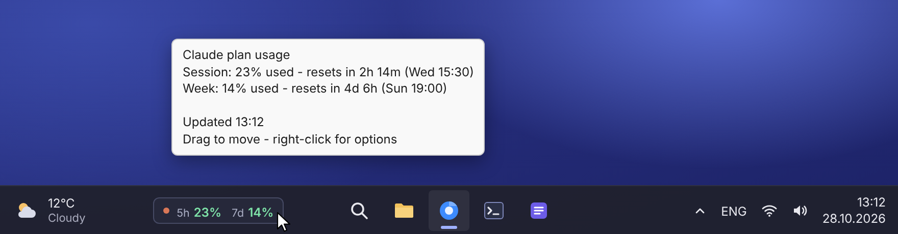
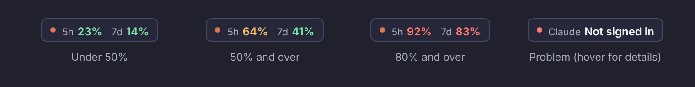

# Taskbar Meter for Claude

A tiny, unofficial Windows widget that shows your **Claude plan usage** right on the taskbar, so you can see how much of your session and weekly limits you have left without opening anything.



- **`5h`**: your current session limit (the rolling 5-hour window)
- **`7d`**: your weekly limit

Hover over it for reset times and any model-specific weekly limits.

> **Note:** This is a community project. It is not made, endorsed or supported by Anthropic.

## Features

- Sits on the taskbar like the built-in weather widget, and you can drag it anywhere
- Color-coded percentages that warn you before you hit a limit
- Hover tooltip with reset countdowns, model-specific weekly limits and extra usage
- Refreshes every 3 minutes, and backs off politely when offline or rate-limited
- Hides itself while a video or game is fullscreen
- Optional start with Windows
- A single PowerShell script with nothing to install and no external dependencies

### Colors



| Color | Meaning |
|---|---|
| Green | Under 50% used |
| Amber | 50% or more used |
| Red | 80% or more used |
| Red dot with a message | Something needs attention. Hover for details. |

## Requirements

- Windows 10 or 11
- Windows PowerShell 5.1 (built into Windows) or PowerShell 7+
- [Claude Code](https://docs.claude.com/en/docs/claude-code/overview) installed and **signed in with your Claude account** (Pro or Max plan)

The widget reads the login that Claude Code already saves on your PC, so there is no separate sign-in or API key.

## Getting started

1. Download `taskbar-meter-for-claude.ps1` (or clone this repository).
2. Open PowerShell in that folder and unblock the file. Windows blocks scripts downloaded from the internet.
   ```powershell
   Unblock-File .\taskbar-meter-for-claude.ps1
   ```
3. Run it:
   ```powershell
   powershell -ExecutionPolicy Bypass -File .\taskbar-meter-for-claude.ps1
   ```

The widget appears on the left side of your taskbar. The PowerShell window hides itself, and the widget keeps running in the background.

### Start with Windows

Right-click the widget and tick **Start with Windows**, or run:

```powershell
.\taskbar-meter-for-claude.ps1 -Autostart On    # turn on
.\taskbar-meter-for-claude.ps1 -Autostart Off   # turn off
```

## Using it

| Action | What it does |
|---|---|
| Hover | Shows reset times and the full breakdown |
| Drag | Moves the widget. The position is remembered. |
| Double-click | Opens your usage page on claude.ai |
| Right-click | Opens the menu: Refresh now, Open usage page, Lock position, Reset position, Start with Windows, Exit |

## How it works

Every 3 minutes the script reads your Claude Code login token from `%USERPROFILE%\.claude\.credentials.json` (or `%CLAUDE_CONFIG_DIR%` if you've set it) and asks `https://api.anthropic.com/api/oauth/usage` for your current limits. Claude Code's own `/usage` command shows the same data.

That endpoint is **undocumented** and may change without notice. If the widget stops showing numbers, see [Troubleshooting](#troubleshooting).

### Privacy

- Your token is only ever sent to `api.anthropic.com`. It is never written anywhere, logged or shown.
- The widget only reads the credentials file and never changes it.
- The only thing it saves is the widget's position, in `%APPDATA%\TaskbarMeterForClaude\settings.json`.
- There is no telemetry, and it makes no other network requests.

## Troubleshooting

| The widget shows | What to do |
|---|---|
| **Not signed in** | Install Claude Code and run `claude` once to sign in with your Claude account. |
| **Login expired** | Claude Code renews its login when you use it. Open Claude Code once and the widget picks it up within a couple of minutes. |
| **Rate limited** | The widget waits 10 minutes and tries again on its own. |
| **Offline** | Check your internet connection. It retries automatically. |
| **No data** | The usage endpoint may have changed. See below. |

To see exactly what the endpoint returns (the output contains only usage numbers, never your token), run:

```powershell
.\taskbar-meter-for-claude.ps1 -DumpJson
```

If the format has changed, please [open an issue](../../issues) and include that output.

**The widget is in the wrong place.** Right-click it and choose **Reset position**.

**Nothing appears when I run it.** It may already be running, since only one copy runs at a time. Look for it on the taskbar, or end any `powershell.exe` process running the script in Task Manager.

## Uninstall

1. Right-click the widget and choose **Exit**.
2. Run `.\taskbar-meter-for-claude.ps1 -Autostart Off` if you had turned on Start with Windows.
3. Delete the script and the `%APPDATA%\TaskbarMeterForClaude` folder.

## License

[MIT](LICENSE)

*Claude is a trademark of Anthropic, PBC. This project is not affiliated with Anthropic.*
